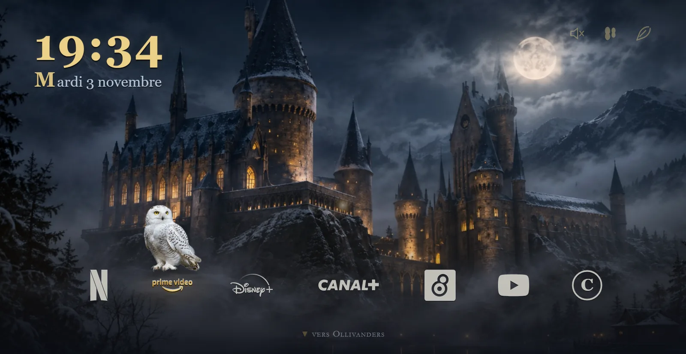
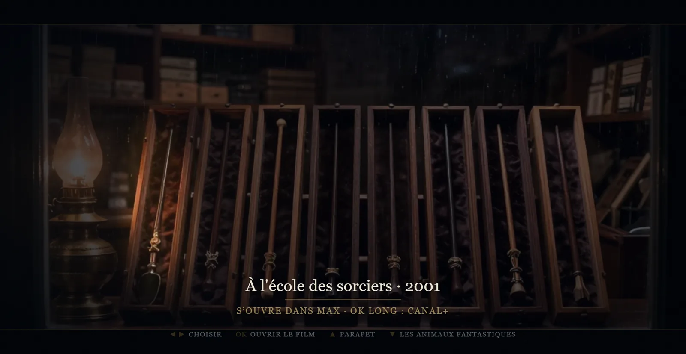
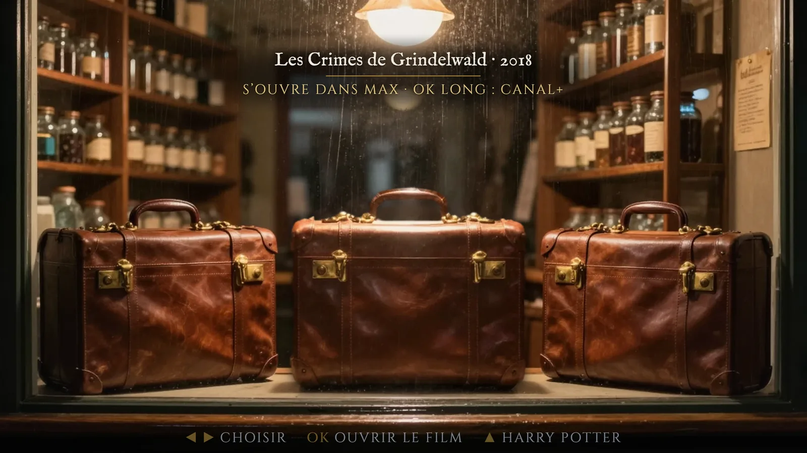
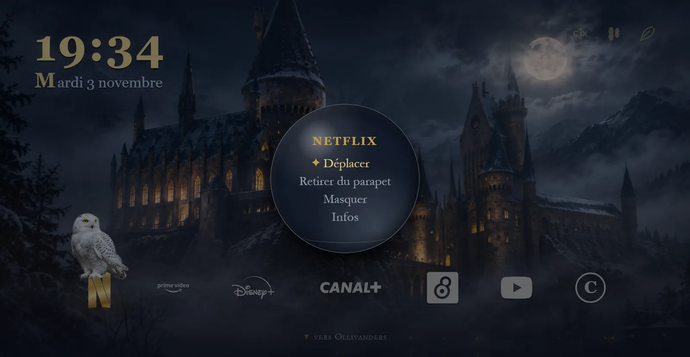
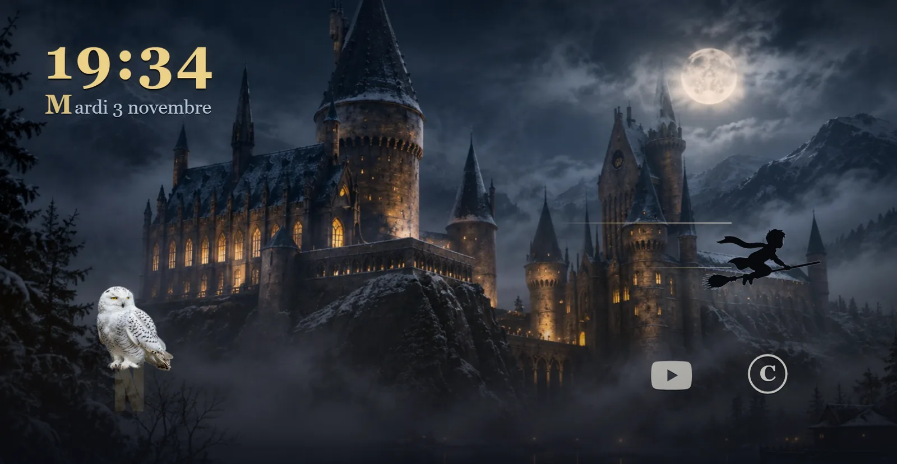
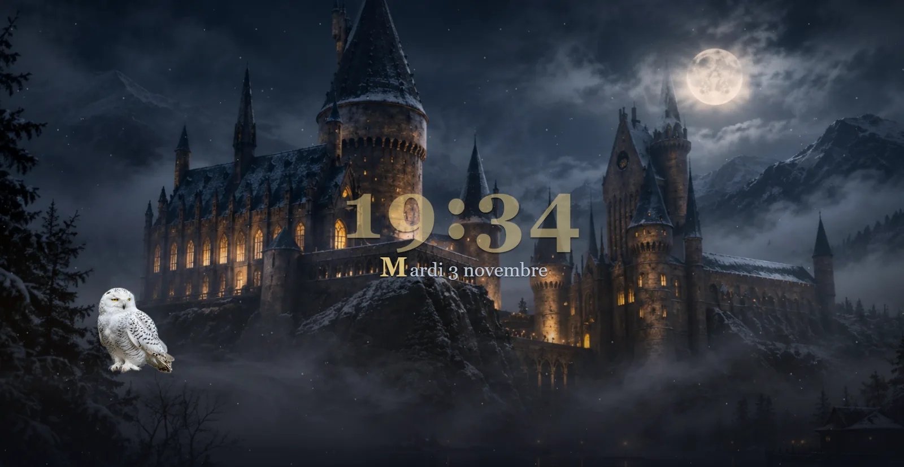
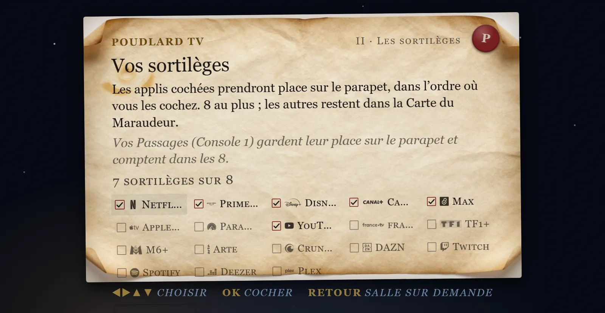

# Poudlard TV

> **En français, pour débutants :** [installer Poudlard TV sur ta télé](INSTALLER.md) · [quelles télés sont compatibles](docs/TELEVISEURS.md) · [créer ta propre interface](docs/PERSONNALISER.md) · [guide pour l'assistant IA](docs/POUR-CLAUDE.md). L'appli prête à installer est sur la [page des versions](https://github.com/Wavia-tech/poudlard-tv/releases/latest).

A TV home screen inspired by the Harry Potter universe: a castle at night, an owl that takes flight when you switch apps, a parapet where the apps sit, and a remote control that does everything.

A fan-made, **unofficial** project, published by [Wavia](https://wav-ia.fr) under the MIT license, for Android TV / Google TV. It is not affiliated with Warner Bros. Discovery, Wizarding World or J.K. Rowling. See `DISCLAIMER.md`.

The web mock-up has no dependencies (ES modules) and is fully driven by the remote's D-pad. The Android port (plain Java, no Gradle) embeds it in a WebView behind an explicit `window.Android` bridge. No network permission, no data collected. At the maintainer's explicit request, the repository also carries the streaming apps' logos, the four house crest pictures and a background music file; they are not covered by the MIT license (`DISCLAIMER.md`, section "Third-party material versioned at the maintainer's request"). Fully reversible: installing never takes the Home key, the original launcher (Google TV's, the manufacturer's, or a third-party one such as Free My TV) is never disabled, Poudlard gives the Home key back to it from one settings row, and a two-second Back press brings a plain mode back from anywhere. Install, app launching, the TV settings entries, the inputs listing and the crash watchdog follow the [Free My TV](https://github.com/simbasjungles/free-my-tv) method (`adb install`, Leanback intents, 3 crashes in 5 minutes → original home), without its internal adb. See `docs/INSTALLATION.md`.

> **Status.** On 3 November 2026 the APK was compiled and run on a real television for the first time: Android TV 11, a 1080p panel (the WebView lays out at 960 × 540 CSS px, device pixel ratio 2), 1.3 GB of RAM, four modest cores, a third-party launcher (Free My TV) as its home. That first test found: no app, film, HDMI input, Home key or TV setting would open (the page called the Java bridge the wrong way); every Canal+ film link was refused; error messages were vague and never said "not installed"; installing took the Home key, and the original home, being a third-party launcher, could not be found again; Android killed the app for memory; the idle Parapet kept more than one CPU core busy and stuttered, under a visible film grain and soft, oversized images; with no network the fonts fell back to system ones; the music was a 28 MB file that did not start on its own and was too quiet against the cues; the Admission Letter overflowed at 960 × 540 and, like Ollivanders, offered apps the TV does not have; in Ollivanders and the Beasts window the selected wand or suitcase could not be seen. Version 0.3 is the round that addresses all of this (`CHANGELOG.md`). **The TV was measured again on 4 and 5 November 2026**: on the last measured build every flow has a median frame of 16.7 to 21 ms and the music file plays, but some long tasks and isolated gaps are still over budget. The work done after that build is checked on a computer only, which says nothing about fluidity. `android/README.md` keeps the test-status box up to date: what is measured, what still fails, what is not measured yet.

**Not affiliated.** Poudlard TV is not affiliated with, endorsed or sponsored by Warner Bros. Discovery, Wizarding World, Google, Amazon, Samsung, TCL, Sony, Hisense, Microsoft, Nintendo, Free My TV or any streaming service named in the interface; their names appear only to designate the devices and apps concerned. The code is MIT; the name, the theme and every reference to the works are used nominatively for a fan project and are not licensed by this repository (`DISCLAIMER.md`).

**Privacy.** Zero permission, verifiable in one line: `aapt dump permissions PoudlardTV.apk` prints nothing. No network, no account, no analytics, no crash reporting; the configuration lives in the app's private storage and leaves with it.

## Screens

Captured from the web mock-up (`app/tv.html`) on the maintainer's own installation, with the app logos versioned in the repository. The Parapet, the Remembrall, both Nox pictures and the Letter date from 3 November 2026 and still show the former gold clock, gold focus and Max logo; they will be captured again once the look is settled.

| The Parapet | Ollivanders |
|---|---|
|  |  |

| The Fantastic Beasts window | The Remembrall |
|---|---|
|  |  |

| Nox, the fly-by | Nox, settled |
|---|---|
|  |  |

| The Admission Letter |
|---|
|  |

## What it is

- **The Parapet** (home): the time, up to eight apps spread across the width, Hedwig (Hedwige) landing on the one you pick. OK lights up (Lumos), then opens the app. When nobody touches the remote, only the clouds move, very slowly, behind the castle.
- **Ollivanders**: the film collection, presented as a wand shop window; OK opens the film in the app that owns it, and says so plainly when that app is not installed.
- **The Marauder's Map** (Carte du Maraudeur): every app, the Passages (HDMI inputs: consoles, set-top boxes), and adding an app by hand.
- **The Room of Requirement** (Salle sur Demande): the settings, all on the D-pad, starting with the Home key (Poudlard TV or the original home) and the TV's own settings (picture, sound, network, remotes…).
- **The Admission Letter** (Lettre d'admission): first launch (house, apps, Hedwig, the emergency exits), under a minute. On the TV it only offers the apps that are actually installed.
- **Plain mode**: a sober home screen, same apps, no scenery. Holding Back for two seconds gets there from any screen, and back again.

All of it in native ES modules, with no dependencies, no bundler and no network access at runtime.

## Demo

Keyboard-driven web mock-up (arrow keys, Enter, Escape, M):

```bash
git clone https://github.com/Wavia-tech/poudlard-tv.git
cd poudlard-tv
node tools/serve.mjs . 8765
```

Then open http://localhost:8765/app/index.html. The test bench shows an on-screen remote and a ×3 slow motion for tuning the gestures; `app/tv.html` is the same interface full screen, as the TV loads it. To see it the way the TV lays it out, set the browser's device emulation to 960 × 540 with a device pixel ratio of 2.

## Installation

- **Web**: the three commands above; details in `docs/INSTALLATION.md`.
- **TV**: build the APK with `android/build.sh` (Java, no Gradle) and install it with `tools/tv.sh install` (or `tools/tv.ps1 install` on Windows). Installing does **not** take the Home key: the TV keeps its current home until you choose « Faire de Poudlard l'accueil » (last page of the Admission Letter, or Salle sur Demande → Accueil de la télé). Full procedure, Chromecast included, in `docs/INSTALLATION.md`; what is borrowed from Free My TV (and what is refused, with the cost of each) in `docs/FREE-MY-TV.md`.

## Reversibility

This is the project's most important rule: you must be able to put the TV back the way you found it, in under a minute, without a computer.

1. Hold Back for 2 s → plain mode (from any screen).
2. Settings → **Accueil de la télé** → Touche Home: **Accueil d'origine** (after a confirmation): the launcher disables its own home entry and gives the Home key back to the home that was the default before it. Poudlard remembers that home at the moment you hand it the key, whether it is Google TV's, the manufacturer's or a third-party launcher such as Free My TV, and never disables it. **Poudlard TV** goes the other way: the TV shows its own confirmation dialog (Android 10+); you make the choice.
3. Uninstalling the app gives Home back too: only the launcher's own entry is ever disabled.
4. From a computer, without the remote: `adb shell cmd package set-home-activity <package>/<activity>` with the home you want, for example `io.freemytv/.HomeActivity`; the candidates are listed by `adb shell cmd package query-activities -a android.intent.action.MAIN -c android.intent.category.HOME`. `tools/tv.sh home original` does it for you. Do not rely on `pm disable-user`: Android 11 refuses it.
5. Three abnormal exits in five minutes: the launcher hands control back on its own and stays out of the way until you ask again (Free My TV method). Back held 6 s opens a native rescue screen whatever the page is doing.

## Security and data

- No network permission in the Android manifest. The fonts (Cinzel, Cinzel Decorative, EB Garamond, IM Fell English) are embedded in `app/assets/fonts/` with their SIL Open Font License, so the TV shows them without a network. No page makes a remote request any more, the desktop test bench (`app/index.html`) included.
- No third-party library, no analytics, no account, no history.
- Apps are launched by explicit intent only, on a package present in the configuration; content links are limited to a whitelist of hosts (Canal+ included), identical in `app/js/platform.js` and `android/src/fr/wavia/poudlardtv/Apps.java`; no URL is ever typed on screen.
- Everything read from storage is validated (`sanitize()`): corrupted storage cannot inject anything.

## Repository layout

```
app/            the web mock-up (index.html, tv.html, js/, css/, assets/); app/README.md and app/CONTRACT.md for the technical details
docs/           screens/ (the captures above), GUIDE.md (the approach, step by step, with the prompts), INSTALLATION.md (web + TV, step by step), FREE-MY-TV.md (what is borrowed from the reference project), MUSIC.md (sounds, background music, rights)
tools/          static server, tv.sh / tv.ps1 (every adb operation on the TV), the owl sprite sheet, assembling your own logos, the method for generating the scenery
android/        Android TV port (plain Java, build.sh, WebView + window.Android bridge)
DISCLAIMER.md, LICENSE (MIT), CONTRIBUTING.md, CHANGELOG.md
```

## Third-party material in the repository

The repository carries, on the maintainer's explicit decision and responsibility, three kinds of files that are not original to the project and are not covered by the MIT license:

- **The app logos** (`app/assets/logos.js`): trademarks of their owners. Anyone can rebuild their own file instead (`tools/README.md`); an app without a logo, such as one added by hand, gets a monogram.
- **The four house crest pictures** (`app/assets/crest-*.webp`), cut out from published artwork owned by Warner Bros.
- **The background music** (`app/assets/music/ambiance.ogg`, Ogg Opus, 19 MB, re-encoded from the maintainer's own recording, from 29:45 to its end): a recording whose rights belong to its author. It can be replaced by any file you hold the rights to (`docs/MUSIC.md`).

Any rights holder may ask for their removal (`DISCLAIMER.md`). Anyone who forks or redistributes this repository does so under their own responsibility for these files.

## License

The code and documentation are under the MIT license (`LICENSE`). This license does not cover the third-party material listed above (app logos, house crest pictures, background music), nor the trademarks mentioned, which remain the property of their owners. The embedded fonts keep their own SIL Open Font License. See `DISCLAIMER.md`.

## Credits

- Starting idea: the reel "I vibecoded my TV to feel like Hogwarts" by @ikevinadams (Instagram).
- Install, switch-over and roll-back method on Android TV: [Free My TV](https://github.com/simbasjungles/free-my-tv) (MIT).
- Fonts: Cinzel, Cinzel Decorative, EB Garamond, IM Fell English (SIL Open Font License), embedded in `app/assets/fonts/`.
- Scenery, owl, glyphs: generated and drawn for this project (`tools/README.md`). House crest pictures: cut out from published artwork owned by Warner Bros. (`DISCLAIMER.md`).
- Interface sounds and the fallback waltz: celesta synthesized in Web Audio, original phrases (`app/js/sound.js`, `docs/MUSIC.md`). Background music file: supplied by the maintainer, rights with its author.
- Design and development: Wavia, Nantes, 2026.

Harry Potter, Hogwarts and the associated names are trademarks of Warner Bros. Entertainment Inc.; the other trademarks mentioned belong to their owners. Fan-made, non-commercial, unofficial project.
